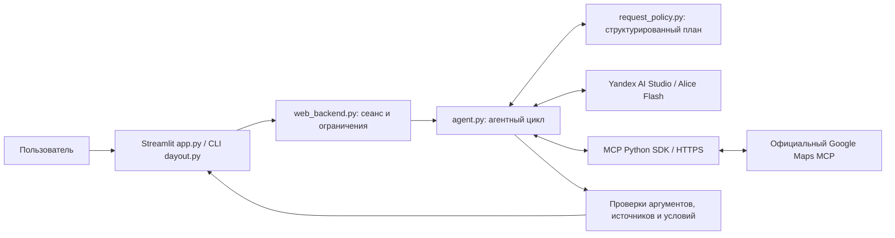
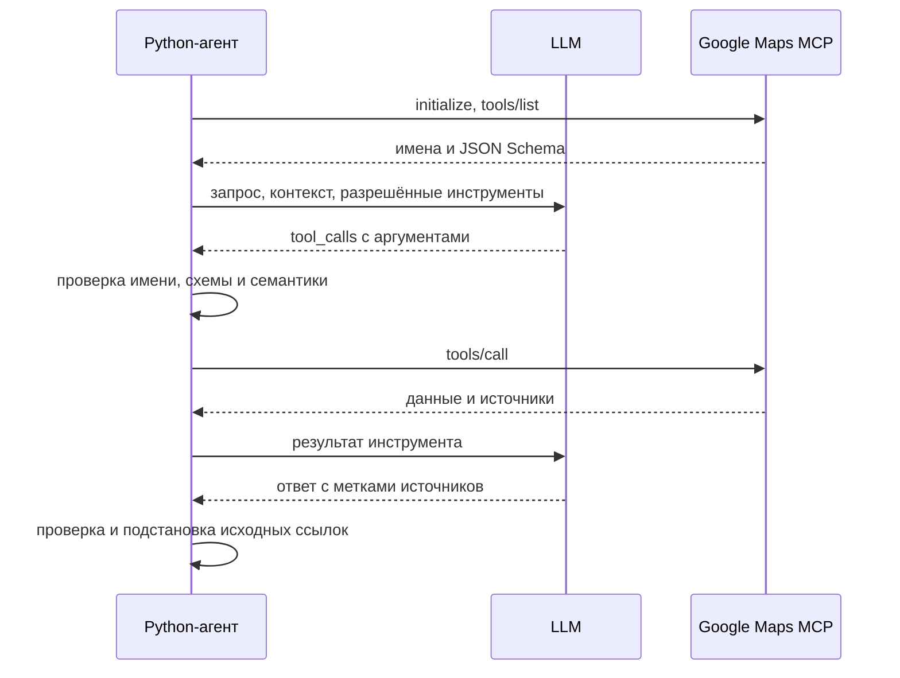

# DayOut — AI-помощник для досуга в Москве

DayOut помогает выбрать место для свидания, прогулки или встречи. Пользователь описывает пожелания обычным текстом; агент ищет данные через официальный Google Maps MCP и составляет ответ со ссылками. Модель — **Alice AI LLM Flash в Yandex AI Studio**, интерфейс — Streamlit.

**[Приложение](https://dayout-ai-agent.streamlit.app/)** · **[HTML-презентация](presentation.html)** · **[PDF](docs/DayOut-presentation.pdf)** · **[Сценарий защиты](docs/defense.md)**

HTML можно скачать и открыть в браузере: слайды и интерактивность работают без интернета. Сам сервис требует сети.

> Состояние на 30.10.2026: веб-прототип реализован, живой Eval проведён частично. Выполнено 39 из 90 основных попыток; продолжение остановлено суточной квотой Google Maps Demo Key, не балансом Яндекса. Полная устойчивость длинного диалога и строгая географическая близость пока не подтверждены. Ниже приведены результаты, включая ошибки.

## Пользователь и сценарий

Для человека, который выбирает досуг в Москве и уточняет район, формат или бюджет по ходу разговора. Пример запросов будущего пользователя, а не сохранённая выдача Maps:

1. «Подбери два музея Москвы для человека, которому интересна история города».
2. «Выбери один из найденных, используя только полученные данные».
3. «Теперь найди рядом кафе. Нас двое, общий бюджет 3000 рублей».
4. «Какая завтра погода в Москве? Нужен прогноз на день».

В деталях ответа видны тип задачи, инструменты, время и токены. Для независимого сценария следует начать новый диалог.

## Границы MVP и критерии готовности

В MVP входят поиск мест, уточнения в сеансе, денежные ограничения, прогноз погоды, пешие маршруты, определение Place ID по названию/ссылке. Основная область проверки — Москва. Другие города не объявляются протестированными.

Бюджет хранится как сумма, валюта, число людей и единица: общий, на человека или на час. **Сохранить бюджет ≠ подтвердить цену.** При отсутствии цен в MCP агент должен сообщать, что попадание в сумму не проверено. Тишина и романтичность также не гарантируются.

За границами MVP: бронирование, билеты, оплата, аккаунты, постоянная история и точный расчёт стоимости вечера. Своей базы заведений и дообучения модели нет. Интегрирован официальный MCP-сервер Google; собственный сервер не реализован.

Критерии приёмки: доступный интерфейс; реальные вызовы пяти инструментов; соответствующие данным ссылки; сохранение и отмена ограничений; контролируемый отказ при недоступности сервиса; воспроизводимый Eval с разбором ошибок. Качество всех сценариев пока не подтверждено. [Сверка с требованиями курса](docs/mvp-readiness.md). Согласование темы с преподавателем репозиторием не подтверждается.

## Архитектура системы



Streamlit Community Cloud размещает Python-приложение. LLM и MCP работают во внешних сервисах, GPU на хостинге не нужен. У каждой браузерной сессии собственная память. Одновременные действия в процессе ограничены; это учебный сервис без SLA.

## Схема MCP-интеграции



Сервер `https://mapstools.googleapis.com/mcp`, транспорт Streamable HTTP, авторизация через серверный заголовок `X-Goog-Api-Key`. Текущее название продукта — **Maps Experience agent tools**, ранее **Maps Grounding Lite**.

| Инструмент | Назначение | Пример |
| --- | --- | --- |
| `search_places` | Кандидаты, сведения и источники | Два музея Москвы |
| `lookup_weather` | Текущая погода, дневной/почасовой прогноз | Москва завтра; отдельно в 22:00 |
| `compute_routes` | Расстояние и длительность пути | Пешком от Красной площади до Волхонки, 12 |
| `resolve_names` | Название/адрес → Place ID | Парк Горького, Москва |
| `resolve_maps_urls` | Ссылка Google Maps → Place ID | Реальная ссылка из предыдущего ответа |

Входные схемы SDK получает через `tools/list`. Фраза «вставь ссылку» без самой ссылки — не положительный тест resolver.

## AI-логика

1. Alice Flash формирует JSON-план: задача, город, район, цель, бюджет, инструменты, дата/час погоды и географический ориентир. План проходит локальную JSON Schema.
2. Модель выбирает вызовы из разрешённых инструментов; Python проверяет и исполняет их.
3. Данные MCP возвращаются модели с метками источников. Приложение заменяет метки исходными URL.
4. Проверяются известность ссылок, часть обещаний о цене/часах/пути и обязательные действия. Допускается одна попытка исправления ответа.

Память ограничена последними успешными ходами, последним поиском мест и текущим планом. Лимиты: 8 попыток MCP, 120 с на ход, ограниченная длина ввода и контекста. Сервер использует текущую дату Москвы. Проверенные `date`/`hour` погоды видны в деталях.

Для «рядом с метро» предусмотрены ориентир, географический bias и пешие маршруты. Bias не является строгим фильтром; приложение дополнительно вычисляет расстояния по полученным координатам. Географическая корректность пока не гарантируется. Допустимая ссылка также не доказывает истинность каждого предложения — это отдельно проверяется в Eval.

## Запуск

Python **3.11 и 3.14** проверяются в CI; локально проверен 3.14. Зависимости закреплены.

```powershell
git clone https://github.com/Batyaoftheyear/DayOut-AI-agent.git
cd DayOut-AI-agent
python -m venv .venv
.\.venv\Scripts\python.exe -m pip install -r requirements.txt
Copy-Item .env.example .env
```

Заполнить `.env` своими значениями:

```dotenv
LLM_PROVIDER=yandex
YANDEX_API_KEY=your-yandex-key
YANDEX_FOLDER_ID=your-folder-id
YANDEX_MODEL=aliceai-llm-flash
GOOGLE_MAPS_API_KEY=your-maps-key
```

Нужны активный платёжный аккаунт Яндекса и ключ с доступом к генерации в каталоге. Maps Demo Key имеет отдельную дневную квоту. Ключи в репозиторий не добавлять. [Настройка Яндекса](docs/yandex.md).

```powershell
.\.venv\Scripts\python.exe -m streamlit run app.py
# Или консоль
.\.venv\Scripts\python.exe dayout.py --usage
```

Открыть `http://localhost:8501`. CLI: `/check`, `/retry`, `/reset`, `/exit`; `--usage` показывает токены. Приоритет настроек: окружение процесса → Streamlit Secrets → `.env`. Groq оставлен для явного выбора, автоматического переключения нет.

Технические тесты не вызывают API и не расходуют деньги:

```powershell
.\.venv\Scripts\python.exe -m pip install -r requirements-dev.txt
.\.venv\Scripts\python.exe -m pytest -q
```

На 30.10.2026: **234 теста пройдены**, `pip check` без конфликтов. Четыре искусственных сценария отказов также пройдены; это не замена живому Eval.

## Развёртывание

В Streamlit Community Cloud: репозиторий, ветка `main`, **Main file path: `app.py`**. В Settings → Secrets задать те же пять параметров в TOML, со значениями в двойных кавычках. Локальный `.env` на хостинг не попадает.

После изменения Secrets перезапустить приложение и начать новый диалог. Загруженная версия видна в «О проекте»: `2026-10-30-r6`. Бесплатное приложение может засыпать — перед защитой открыть заранее. [Пошаговая инструкция](docs/deployment.md).

## Eval и разбор ошибок

Измеренный код: тег [`eval-r6-2026-10-30`](https://github.com/Batyaoftheyear/DayOut-AI-agent/tree/eval-r6-2026-10-30), commit `90aef8f`. SHA-256 кода и датасета записаны в отчётах. Последующие изменения документации не меняют измеренный агент.

Дизайн: **30 основных сценариев / 37 ходов**, 20 development / 10 holdout, по 3 попытки — план 90 попыток. Дополнительно: 5 сценариев / 23 хода, включая 15-ходовый диалог; 4 искусственных сценария отказов. Проверяются все инструменты, районы, категории, бюджет, цены, даты, маршруты, ссылки, уточнения и ошибки.

Фактически 30.10.2026: **39 основных попыток, 23 различных сценария**; 51 попытка отложена из-за дневной квоты Maps. Это неполный прогон, ограниченный доступностью сервисов.

| Показатель | Development | Holdout | Всего |
| --- | ---: | ---: | ---: |
| Попыток / план | 36 / 60 | 3 / 30 | **39 / 90** |
| Технически завершено | 32 | 2 | **34 / 39 (87,2%)** |
| Все критерии пройдены | 25 | 2 | **27 / 39 (69,2%)** |
| Ошибки качества | 9 | 0 | 9 |
| Инфраструктурные отказы | 2 | 1 | 3 |

Без инфраструктурных отказов прошли 27/36 (75%). Это отдельный знаменатель, он не заменяет сквозные 69,2%. Двух успешных holdout-примеров недостаточно для вывода о новых запросах. Медиана основного пользовательского хода — **15,45 с**, p95 — **28,42 с**; учитываются и неуспешные ходы, паузы между сценариями исключены.

Ответы сравнивает с данными MCP отдельный LLM-запрос той же Alice Flash. Это **LLM-assisted review**, не независимая человеческая разметка. Выполнена выборочная сверка отдельных фактов и ссылок, полного человеческого аудита нет. Поле JSON `manual_scores` используется и для оценок модели; метод указан в метаданных.

| Наблюдение | Исправление или открытое ограничение |
| --- | --- |
| Повторяющиеся ID вызовов ломали цикл | ID нормализуются, соответствие результатам сохраняется; технические тесты проходят |
| Погода отказывала с явным `languageCode` | С текущим ключом поле исключено; дневной прогноз через агента прошёл. Почасовой итоговый holdout не выполнен |
| Далёкие места в запросе «рядом» | Добавлены проверки расстояния и пешего пути; оба B07 ещё не прошли проверку аргументов. Близость не объявлена решённой |
| Уточнение вместо нужного поиска | B03 и T07 не выполнили нужные действия; остаётся ошибка планирования |
| Неподтверждённые детали описаний | Часть completed-ответов получила fail за grounding и не включена в успех |
| Длинный диалог | L01 дал 11 ответов, затем runner остановился на ошибке погоды. Отдельный стресс-прогон дал 3 ответа из 15 и остановился на пропуске поиска. Устойчивость не подтверждена |
| Maps HTTP 429 | Подтверждён дневной лимит Demo Key; баланс Яндекса его не меняет |

Дополнительная цепочка поиск → ссылка → имя → пеший маршрут прошла все 4 хода (E01). Все пять инструментов вызывались в основном и дополнительном наборах вместе. Из 5 дополнительных сценариев 3 прошли, 1 провалил критерий содержания, 1 остановлен на ошибке сервиса. Эти показатели не подмешиваются в основную таблицу.

Основные 39 попыток с разметкой: **около 36,95 ₽**. Все сохранённые прогоны разработки и проверки за 30.10: **около 113,39 ₽**. Расчёт по usage: 0,10 ₽/1000 входных, 0,20 ₽/1000 выходных, без скидок за кэш/токены инструментов. Это не выписка биллинга; расходы Maps не включены.

**[Методика и команды продолжения](docs/evaluation.md)** · [Сводный JSON](eval/results/final-summary-2026-10-30.json) · [Основной набор](eval/cases.json) · [Дополнительный набор](eval/extended_cases.json) · [Отчёты](eval/results/README.md)

## Данные и ограничения

Ключи остаются на сервере. Постоянной базы диалогов нет; данные MCP используются в памяти сеанса. Публичные отчёты содержат метрики и категории ошибок без сырых ответов Maps, названий, адресов, Place ID и ссылок выдачи. Скриншоты интерфейса сделаны в пустом диалоге.

В запросах Яндексу указан `x-data-logging-enabled: false`; это не универсальная гарантия ZDR и не юридическое подтверждение совместимости условий двух провайдеров. Политики хранения и правила Maps нужно проверять при изменении интеграции. Не вводите чувствительные персональные данные в публичный учебный сервис.

## Структура

| Файлы | Назначение |
| --- | --- |
| `app.py`, `web_backend.py`, `assets/` | Интерфейс, сеансы, оформление |
| `agent.py`, `request_policy.py`, `geo.py` | Агент, планирование, проверки |
| `provider_config.py`, `yandex_client.py` | Конфигурация и адаптер LLM |
| `mcp_check.py`, `yandex_check.py`, `dayout.py` | Диагностика и CLI |
| `eval_runner.py`, `eval/`, `tests/` | Eval и технические проверки |
| `presentation.html`, `docs/` | Материалы защиты |

## Источники

- [Google Maps Experience agent tools](https://developers.google.com/maps/ai/maps-experience-agent-tools) — официальный MCP, ранее Grounding Lite.
- [Maps Demo Key](https://developers.google.com/maps/demo-key) — дневные квоты и прототипирование.
- [MCP Python SDK](https://github.com/modelcontextprotocol/python-sdk).
- [Yandex Chat Completions](https://aistudio.yandex.ru/ru/docs/ai-studio/api/Chat-Completions/createChatCompletion) — генерация и инструменты.
- [Тарифы Яндекса](https://aistudio.yandex.ru/ru/docs/ai-studio/pricing) — расчёт, проверены 30.10.2026.
- [Streamlit Community Cloud](https://docs.streamlit.io/deploy/streamlit-community-cloud) — размещение и Secrets.
- Требования курса, предоставленные автором: задача, MCP, сервис/хостинг, Eval/воспроизводимость, интерактивное HTML-демо до 10 минут.
