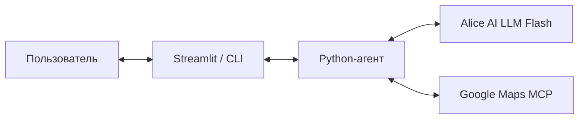

# DayOut — куда пойти в городе

DayOut подбирает места для прогулки, свидания или встречи. Достаточно описать, чего хочется: район, кухню, компанию, бюджет. В том же разговоре можно изменить пожелания, узнать погоду и построить маршрут. Сведения о местах приложение получает из Google Maps, а ответы составляет Alice AI LLM Flash.

**[Попробовать DayOut](https://dayout-ai-agent.streamlit.app/)** · **[Презентация](https://batyaoftheyear.github.io/DayOut-AI-agent/presentation.html)** · **[Скачать PDF](docs/DayOut-presentation.pdf)**

Python · Streamlit · Yandex AI Studio · Google Maps MCP

## Для кого

Для тех, кто планирует вечер или выходной и хочет выбрать из нескольких мест, не составляя новый поисковый запрос после каждого уточнения. Основные сценарии проекта проверены на Москве.

Пример разговора:

> Подбери два уютных кафе в центре Москвы. Нас двое, общий бюджет 3000 рублей.
>
> Лучше в Нагатино, грузинская кухня.
>
> Какая завтра погода? Если будет дождь, останемся в помещении.

Пользователь меняет условия постепенно. Приложение передаёт модели историю разговора и сохраняет район, предпочтения и бюджет между сообщениями.

## Что входит в MVP

- Поиск заведений, парков, музеев и других городских мест со ссылками на Google Maps.
- Уточнения в диалоге: другой район, кухня, состав компании или бюджет.
- Текущая погода, дневной и почасовой прогноз.
- Пешие и автомобильные маршруты с расстоянием и временем в пути.
- Определение Place ID — идентификатора места — по названию, адресу или ссылке.

Бронирование, покупка билетов и личный кабинет в MVP не входят. Цены и часы работы доступны в той мере, в какой их возвращает Maps.

Критерии готовности: приложение доступно по ссылке, модель вызывает инструменты MCP, рекомендации содержат источники, запуск описан в README, результаты проверки опубликованы. Интегрирован официальный MCP-сервер Google.

## Как устроено приложение



| Компонент | За что отвечает |
| --- | --- |
| Alice AI LLM Flash, Yandex AI Studio | Понимает запрос и уточнения, выбирает инструмент, составляет ответ |
| Python-агент | Хранит историю, проверяет параметры, выполняет вызовы, проверяет ссылки и время маршрутов |
| Google Maps MCP | Возвращает сведения о местах, прогноз погоды и расчёт маршрутов |
| Streamlit | Показывает разговор, ссылки, время ответа и использованные инструменты |

Приложение размещено в Streamlit Community Cloud. Модель работает через API, поэтому GPU на хостинге не нужен. История хранится в памяти отдельного сеанса; общей базы разговоров нет. В одном процессе запросы выполняются по очереди.

### Цикл работы агента

1. Модель получает сообщение, историю диалога и описания пяти инструментов.
2. Если нужны данные, она возвращает вызов инструмента с аргументами.
3. Python проверяет аргументы, отправляет вызов MCP-серверу и возвращает результат модели.
4. Модель использует полученные данные: вызывает следующий инструмент, задаёт уточнение или отвечает пользователю.

Отдельный короткий запрос к модели обновляет сохранённые условия разговора. Кухня, атмосфера и другие пожелания записываются обычным текстом. Решение о следующем действии остаётся за основным агентом.

Перед показом ответа приложение проверяет ссылки и служебный текст. При исправимой ошибке модель получает запрос на исправление. На одно сообщение отведено до 8 обращений к Maps и 120 секунд; повторный расчёт того же маршрута в этом сообщении использует сохранённый результат.

### MCP-интеграция

**Сервер:** `https://mapstools.googleapis.com/mcp` · **Транспорт:** Streamable HTTP · **Клиент:** MCP Python SDK.

После подключения приложение выполняет `initialize`, получает описания инструментов через `tools/list` и вызывает их через `tools/call`. Ключ Maps передаётся сервером приложения в заголовке `X-Goog-Api-Key`.

| Инструмент | Назначение |
| --- | --- |
| `search_places` | Поиск мест и сведений о выбранном заведении |
| `lookup_weather` | Погода сейчас и прогноз на нужную дату |
| `compute_routes` | Маршрут, расстояние и время в пути |
| `resolve_names` | Place ID по названию или адресу |
| `resolve_maps_urls` | Place ID по ссылке Google Maps |

Python подставляет в последующие вызовы координаты и идентификаторы найденных мест. Аргументы проверяются по JSON-схемам, полученным от сервера.

### Бюджет и время в пути

Бюджет сохраняется вместе с валютой и числом участников. Если Maps возвращает расходы на человека, агент сопоставляет их с общей суммой. Например, диапазон 3000–8000 ₽ на человека для двоих начинается от 6000 ₽. При общем бюджете 5000 ₽ такой вариант выходит за его пределы. Сведения о ценах есть не у каждого места; диапазон расходов не заменяет стоимость конкретного заказа.

Условие «не больше 10 минут пешком» проверяется по маршруту. Расстояние по прямой для этого не подходит. Если пользователь просит просто «рядом», поиск можно расширить, указав более долгое время пути.

## Запуск

Требуется Python 3.11 или 3.14. Команды для PowerShell:

```powershell
git clone https://github.com/Batyaoftheyear/DayOut-AI-agent.git
cd DayOut-AI-agent
python -m venv .venv
.\.venv\Scripts\python.exe -m pip install -r requirements.txt
Copy-Item .env.example .env
```

Заполните `.env` своими ключами:

```dotenv
LLM_PROVIDER=yandex
YANDEX_API_KEY=your-yandex-key
YANDEX_FOLDER_ID=your-folder-id
YANDEX_MODEL=aliceai-llm-flash
GOOGLE_MAPS_API_KEY=your-maps-key
```

Для Yandex AI Studio нужны платёжный аккаунт и ключ с правом генерации. Для Maps — доступ к Maps Experience agent tools. [Настройка Yandex AI Studio](docs/yandex.md). Ключи и `.env` не должны попадать в репозиторий.

```powershell
.\.venv\Scripts\python.exe -m streamlit run app.py
```

Приложение откроется по адресу `http://localhost:8501`. Консольная версия: `python dayout.py --usage`. Команды: `/check` — проверить подключение, `/retry` — повторить запрос, `/reset` — очистить диалог, `/exit` — выйти. Флаг `--usage` показывает расход токенов.

### Развёртывание в Streamlit Community Cloud

Выберите репозиторий, ветку `main` и файл **`app.py`**. В Settings → Secrets добавьте настройки по образцу [.streamlit/secrets.toml.example](.streamlit/secrets.toml.example). После изменения настроек перезапустите приложение и начните новый диалог. Приоритет настроек: окружение процесса → Streamlit Secrets → локальный `.env`.

[Полная инструкция по развёртыванию](docs/deployment.md).

## Оценка качества — Eval

Основной набор включает 30 сценариев и 37 сообщений: поиск мест, уточнения, бюджет, погоду, маршруты и определение Place ID. Отдельно проверялся разговор из 15 сообщений.

Программа проверяет вызванные инструменты, параметры и сохранение условий. Содержание ответа оценивает отдельный запрос к той же модели: ему передаются условия задачи и полученные данные MCP. Такая оценка может ошибаться и не заменяет проверку человеком.

| Проверка | Сценариев | Завершены | Прошли все критерии | Получено ответов |
| --- | ---: | ---: | ---: | ---: |
| [Основной набор · Flash · 02.11.2026 · r10](eval/results/release-r10-2026-11-02.json) | 30 | 29 | 20 | 36 из 37 попыток |
| [Длинный диалог · Flash · 02.11.2026 · r12](eval/results/long-dialogue-repeat-r12-2026-11-02.json) | 1 | 0 | 0 | 13 из 14 попыток; запланировано 15 |

В основном наборе медианное время ответа — **16,9 секунды**. Из 30 сценариев в девяти были ошибки качества, один прервался из-за внешнего сбоя. Длинный диалог остановился на сетевом таймауте.

Текущая модель приложения — **Alice AI LLM Flash**, версия агента — **r34**. В таблице указаны версии измерений; полный набор после последних изменений не повторялся. Первые неудачные попытки включены в отчёты.

### Что выявили проверки

| Проблема | Изменения в приложении |
| --- | --- |
| Модель печатала команду поиска вместо её вызова | Добавлена проверка служебного текста и повторная попытка вызвать инструмент |
| При уточнении терялись район, кухня или бюджет | Сохраняются история и условия разговора, в том числе после неудачного ответа |
| Место рекомендовалось без проверки заданного времени пешком | Добавлено сопоставление длительности маршрута с пределом пользователя |
| Цены отсутствовали в общей выдаче | Для выбранного заведения можно выполнить отдельный запрос о расходах |

Несмотря на проверки, модель может неверно выбрать место или описать его. [Методика и разбор результатов](docs/evaluation.md) · [Исходные отчёты](eval/results/README.md).

### Автоматические тесты

Тесты проверяют цикл агента, память диалога, ссылки, маршруты, подключение Yandex, веб-интерфейс и расчёт результатов Eval. Вместо внешних API используются тестовые ответы; ключи и платные запросы для запуска не нужны.

```powershell
python -m pip install -r requirements-dev.txt
python -m pytest -q
python -m pip check
```

## Структура проекта

| Файл | Содержание |
| --- | --- |
| `app.py`, `web_backend.py` | Веб-интерфейс, сеансы и подключения |
| `agent.py` | Цикл вызовов инструментов и проверки ответов |
| `conversation_context.py`, `literal_constraints.py` | Условия разговора, сумма бюджета и предел времени пешком |
| `yandex_client.py`, `provider_config.py` | Запросы к модели и настройки |
| `geo.py` | Расстояния и длительность маршрутов |
| `eval_runner.py`, `eval/` | Сценарии оценки и отчёты |
| `tests/` | Автоматические тесты |

## Данные

Ключи используются только на сервере. Диалог и ответы Maps хранятся в памяти сеанса. В опубликованных отчётах остаются метрики и категории ошибок без сырых ответов Maps. Запросы к Yandex отправляются с `x-data-logging-enabled: false`.

## Документация используемых сервисов

- [Google Maps Experience agent tools](https://developers.google.com/maps/ai/maps-experience-agent-tools)
- [Search places](https://developers.google.com/maps/ai/maps-experience-agent-tools/search-places)
- [MCP Python SDK](https://github.com/modelcontextprotocol/python-sdk)
- [Yandex AI Studio: Chat Completions](https://aistudio.yandex.ru/ru/docs/ai-studio/api/Chat-Completions/createChatCompletion)
- [Тарифы Yandex AI Studio](https://aistudio.yandex.ru/ru/docs/ai-studio/pricing)
- [Streamlit Community Cloud](https://docs.streamlit.io/deploy/streamlit-community-cloud)
