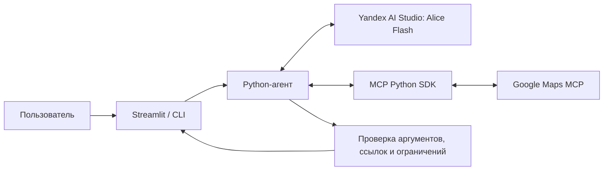
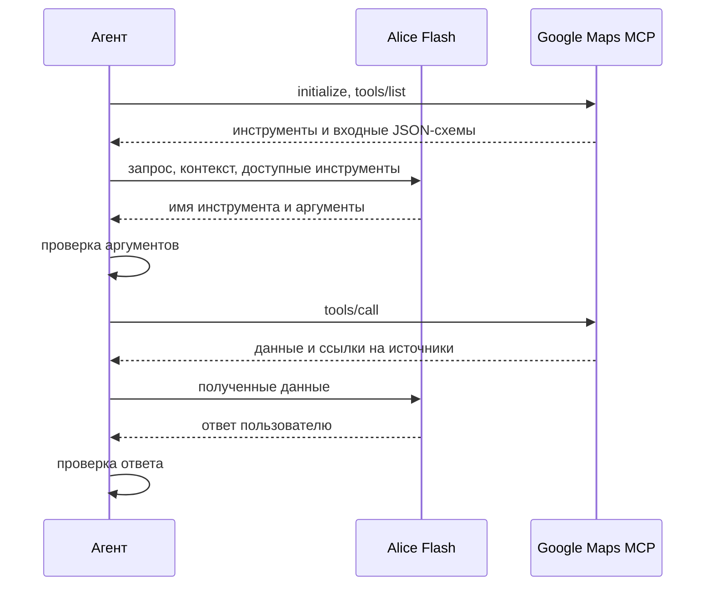

# DayOut — AI-помощник для досуга в Москве

DayOut помогает выбрать место для прогулки, свидания или встречи. Пользователь описывает пожелания обычным текстом, а приложение ищет места через Google Maps, проверяет погоду и строит пешие маршруты. Ответ содержит ссылки на источники и предупреждения о неизвестных данных.

**[Веб-приложение](https://dayout-ai-agent.streamlit.app/)** · **[Интерактивная презентация](https://batyaoftheyear.github.io/DayOut-AI-agent/presentation.html)** · **[PDF](docs/DayOut-presentation.pdf)** · **[План выступления](docs/defense.md)**

Стек: Python, Streamlit, Alice AI LLM Flash в Yandex AI Studio, официальный Google Maps MCP.

## Пользователь и сценарий

Для человека, который планирует досуг в Москве и хочет сравнить несколько мест, не собирая сведения вручную из разных сервисов.

Пример диалога:

> «Найди красивые места для прогулки вдвоём на юге Москвы».
>
> «Теперь подбери кафе в Нагатино. Нас двое, общий бюджет 3000 рублей».
>
> «Лучше ресторан. Остальные условия прежние».
>
> «Какая погода в Москве завтра?»

При уточнениях сохраняются применимые условия. Новый район или тип места вызывает новый поиск. В деталях ответа видны инструменты, время и расход токенов. Пример выше описывает сценарий использования, а не фиксированный результат поиска.

## Границы MVP

Реализованы поиск мест, уточнения в диалоге, денежные ограничения, текущая погода и прогноз, пешие маршруты, определение Place ID по названию и ссылке Google Maps. Основная область проверки — Москва.

Система не бронирует столики, не продаёт билеты, не принимает оплату и не хранит постоянный профиль пользователя. Точные цены, наличие мест и субъективная атмосфера не гарантируются. В проекте интегрирован готовый официальный MCP-сервер Google; собственный MCP-сервер не разрабатывался.

Критерии готовности MVP:

- приложение доступно по публичной ссылке;
- пять MCP-инструментов используются в реальных сценариях;
- ответы сопровождаются источниками, неизвестные сведения явно обозначаются;
- ограничения диалога сохраняются, изменяются и отменяются;
- качество проверено воспроизводимым Eval с разбором неуспехов.

## Архитектура



Streamlit Community Cloud размещает Python-приложение. Модель и геоданные доступны через внешние API, поэтому GPU на хостинге не нужен. Память хранится в сеансе браузера; разные сеансы не разделяют историю. В одном процессе одновременно обрабатывается один пользовательский запрос.

Основные модули: `app.py` — интерфейс; `web_backend.py` — сеансы и выполнение запросов; `agent.py` — цикл инструментов и проверки; `conversation_context.py` — память условий разговора; `yandex_client.py` — адаптер модели; `geo.py` — расчёт расстояний.

## MCP-интеграция



Сервер: `https://mapstools.googleapis.com/mcp`. Транспорт: Streamable HTTP. Ключ передаётся сервером приложения в заголовке `X-Goog-Api-Key`. Название продукта Google — Maps Experience agent tools, ранее Maps Grounding Lite.

| Инструмент | Назначение | Пример |
| --- | --- | --- |
| `search_places` | Поиск мест и сведений о них | Кафе для встречи в центре Москвы |
| `lookup_weather` | Текущая погода, дневной и почасовой прогноз | Погода завтра в Москве |
| `compute_routes` | Расстояние и длительность пути | Пешком от Красной площади до Волхонки, 12 |
| `resolve_names` | Название или адрес → Place ID | Парк Горького, Москва |
| `resolve_maps_urls` | Ссылка Google Maps → Place ID | Ссылка на место из предыдущего ответа |

Входные схемы загружаются через MCP, а не составляются моделью. Python проверяет вызовы перед исполнением. Для поиска у конкретного метро сначала определяются координаты станции, затем кандидаты поблизости и пеший путь. Расстояние по прямой само по себе не подтверждает время ходьбы.

## AI-логика

1. Alice Flash получает связный диалог, сохранённые условия и схемы всех пяти MCP-инструментов. Она выбирает следующий шаг: уточнить вопрос, вызвать инструмент или ответить. Отдельного предварительного планировщика и классов запросов, разрешающих инструменты, нет.
2. Python проверяет настоящий `tool_call`, выполняет его и возвращает данные модели. Цикл продолжается, пока данных достаточно для ответа. Модель сама формулирует поисковые запросы и понимает пожелания: кухня, веранда и посещение с собакой не требуют отдельных ветвей кода.
3. Перед показом готового ответа отдельный вызов модели через локальный `remember_context` сохраняет полный снимок условий: город, район, занятие, свободный список пожеланий, бюджет и пеший ориентир. Это проверка памяти после решения задачи, а не план поиска; она не запрещает MCP-инструменты. Уже подготовленный ответ проверяется с учётом сохранённых условий.
4. Приложение проверяет ссылки, формат ответа и часть явных противоречий. Напечатанный моделью JSON с командами считается ошибкой: он не исполняется и не показывается пользователю. Модель получает возможность исправить ответ с доступом к инструментам.

В историю входят последние 20 пар «пользователь — ассистент», включая уточняющие вопросы, сохранённые условия и ограниченный объём предыдущих данных инструментов. Поэтому ответ «Осака» продолжает исходную просьбу, а не становится новой самостоятельной задачей.

Названный ориентир, например Osaka Castle, можно искать без отдельно указанного города. Подтверждённый через Maps город сохраняется в памяти. При нескольких возможных местах агент должен уточнить ориентир. **15 минут пешком — мягкий начальный ориентир:** если подходящего места нет, поиск расширяется примерно до 2,5–3 км, затем проверяется маршрут и явно указывается более долгий путь. Явный строгий предел пользователя сохраняется.

История и число действий ограничены: до 8 попыток MCP и 120 секунд на один ход. Проверки уменьшают число ошибок, но не доказывают истинность каждого предложения модели. Эта граница отдельно оценивается в Eval.

### Как учитывается бюджет

Сохраняются сумма, валюта, число людей и единица ограничения: общий бюджет, на человека или за час. Изменение суммы заменяет старую; отменённое ограничение не должно возвращаться.

**В используемом `search_places` нет отдельного фильтра по цене и обязательного поля со средним чеком.** Цены могут встретиться в текстовой сводке, но актуальное меню, стоимость билетов и итоговая сумма доступны не всегда. Поэтому сохранение бюджета не означает строгую фильтрацию заведений по чеку.

Если цены не подтверждены, ответ называет найденные места кандидатами и сообщает о необходимости проверить стоимость. Например, «3000 ₽ на двоих» — условие пользователя, а не полученная от Maps цена. Гарантия попадания в сумму без цен была бы недостоверной.

## Запуск локально

Python 3.11 или 3.14. Зависимости закреплены в `requirements.txt`.

```powershell
git clone https://github.com/Batyaoftheyear/DayOut-AI-agent.git
cd DayOut-AI-agent
python -m venv .venv
.\.venv\Scripts\python.exe -m pip install -r requirements.txt
Copy-Item .env.example .env
```

Заполнить `.env` собственными значениями:

```dotenv
LLM_PROVIDER=yandex
YANDEX_API_KEY=your-yandex-key
YANDEX_FOLDER_ID=your-folder-id
YANDEX_MODEL=aliceai-llm-flash
GOOGLE_MAPS_API_KEY=your-maps-key
```

Для Яндекса нужны активный платёжный аккаунт и ключ с правом генерации в указанном каталоге. Maps использует собственные ключ и квоту. Секреты не добавляются в Git. [Настройка API](docs/yandex.md).

```powershell
.\.venv\Scripts\python.exe -m streamlit run app.py
```

Открыть `http://localhost:8501`. Альтернатива — `python dayout.py --usage`; консольные команды: `/check`, `/retry`, `/reset`, `/exit`. Флаг `--usage` показывает расход токенов.

## Развёртывание

В Streamlit Community Cloud выбрать репозиторий, ветку `main`, **Main file path: `app.py`**. В Settings → Secrets задать те же пять параметров в TOML, со значениями в двойных кавычках. Локальный `.env` на хостинг не загружается.

После изменения Secrets перезапустить приложение и начать новый диалог. Приоритет настроек: окружение процесса → Streamlit Secrets → `.env`. Бесплатное приложение может засыпать; перед демонстрацией его следует открыть заранее. [Инструкция](docs/deployment.md).

## Eval: методика и результаты

Основной набор измерен на `2026-11-02-r10`, commit `bab605a`, тег [`eval-r10-2026-11-02`](https://github.com/Batyaoftheyear/DayOut-AI-agent/tree/eval-r10-2026-11-02). Публичная реализация — `2026-11-03-r18` ([зафиксированный код](https://github.com/Batyaoftheyear/DayOut-AI-agent/tree/eval-r18-2026-11-03)). Проверки последующих версий выделены отдельно; основной набор не объявляется измерением r18. В отчётах сохранены SHA-256 кода и наборов сценариев.

Основной набор — **30 сценариев / 37 реплик**, один полный прогон: **30 попыток / 37 запланированных реплик**. Среди сценариев — разные виды досуга, смена района и категории, бюджет, текущая и прогнозная погода, маршруты и оба способа определения Place ID. 20 сценариев используются при разработке, 10 отложены для итоговой проверки. Дополнительный набор включает 15-ходовый диалог и исходный запрос о прогулке на юге Москвы.

| Показатель полного основного прогона | Результат |
| --- | ---: |
| Проверено сценариев | 30 / 30 |
| Получены все ответы сценария | 29 / 30 (96,7%) |
| Пройдены все критерии | 20 / 30 (66,7%) |
| Ошибки качества / внешние отказы | 9 / 1 |
| Реплик с попыткой / полученным ответом | 37 / 36 |
| Медиана / p95 времени реплики | 16,87 / 30,09 с |

Техническое завершение — получены все ответы сценария. Успех по качеству — пройдены все автоматические условия и все критерии содержания: соответствие задаче и ограничениям, опора на данные, честное обозначение неизвестного и выбор инструментов. Отказ внешнего сервиса остаётся неуспехом сквозного сценария.

Содержание оценивает отдельный запрос к той же Alice Flash по исходным данным MCP. Это LLM-оценка, а не независимая экспертная разметка; она может ошибаться. Выборочная сверка не заменяет полного человеческого аудита. Реальные ответы Maps не публикуются: в отчётах только метрики, пользовательские ограничения и категории ошибок.

| Набор | Версия | Попыток | Все ответы получены | Все критерии пройдены |
| --- | --- | ---: | ---: | ---: |
| Основной, живые API | r10 | 30 | 29 | 20 |
| Дополнительный, живые API | r10 | 6 | 4 | 4 |
| Проверка исправлений, живые API | r11 | 8 | 5 | 4 |
| Заключительная, живые API | r12 | 2 | 1 | 1 |
| 15 реплик, реальная LLM + искусственные инструменты | r12 | 1 | 1 | 1 |
| После восстановления Maps, живые API | r12 | 2 | 1 | 1 |
| Повтор длинного диалога, живые API | r12 | 1 | 0 | 0 |

В повторном прогоне r12 с настоящими Yandex AI Studio и Google Maps получены **13 из 15 ответов**. На 14-й реплике клиент не дождался ответа Yandex AI Studio после двух попыток генерации (ReadTimeout). Maps в этом прогоне ошибок не возвращал. Полная устойчивость длинного диалога с реальными сервисами не подтверждена. Первая попытка r12 остановилась на седьмой реплике из-за дневной квоты Demo Key. После восстановления доступа первая новая попытка остановилась на пятой реплике из-за сети; оба неуспеха сохранены отдельно. Контрольный диалог с реальной LLM и искусственными данными инструментов также дал 15/15 ответов, но не используется как доказательство доступности Maps.

Доли качества разных версий не объединяются. Полные показатели относятся к основному прогону r10; последующие исправления проверены отдельно. Во всех наборах сохраняются исходные неуспехи, включая сетевые отказы.

Отдельная [проверка кухни на r13](eval/results/cuisine-r13-2026-11-02.json): **2/2 сценария, 4/4 ответа**, все автоматические и модельные критерии пройдены. После поиска ресторанов в Кузьминках уточнения «грузинскую кухню» и «грухинскую кухню» вызывают новый поиск с сохранением района; во втором сценарии сохраняется бюджет 3000 ₽ на двоих. Это целевая проверка исправления, не повтор основного набора. Расчётный расход этой проверки — около **2,87 ₽**, отдельно от семи наборов ниже; стоимость Maps не включена.

В r14 частное поле кухни заменено общим механизмом пожеланий. [Проверка r14](eval/results/preferences-r14-2026-11-03.json): **3/3 сценария, 12/12 ответов**, все автоматические и модельные критерии пройдены. Проверены добавление и отмена разных пожеланий, сокращение ответа без поиска, запоминание условия с последующим поиском, доступность музеев, погода и маршрут. Расход этой отдельной проверки — около **9,63 ₽**, без стоимости Maps; в сводку r10–r12 он не включён. Небольшой целевой набор не гарантирует правильную обработку всех возможных формулировок.

В [целевом прогоне прямого цикла r18](eval/results/conversation-r18-2026-11-03.json) проверены 6 сценариев: получено **10/11 ответов**, все критерии прошли **3/6 сценариев**. Медиана времени реплики — 14,01 с. Проверяются ориентир без города, ответ «Осака» после уточнения, неоднозначное название храма, бюджет и пожелания, погода, маршрут и оба resolver. Отдельно [реальная LLM с искусственными маршрутами](eval/results/proximity-controlled-r18-2026-11-03.json): 0/2 сценария прошли все критерии; автоматические проверки выбора области — 2/2. Google Maps в этом режиме не вызывается. Эти небольшие целевые прогоны не заменяют основной набор и не доказывают устойчивость всех формулировок. [Методика и исходные неуспехи r15–r17](docs/evaluation.md#прямой-цикл-выбора-действий-r15r18).

По известным токенам основной прогон — **около 30,97 ₽** с модельной оценкой. Семь опубликованных оценочных наборов в таблице вместе — **около 81,96 ₽ по учтённому usage**. У 5 запросов usage отсутствует, поэтому полный расход не установлен. Это расчёт без скидок за кэш, не счёт провайдера; предыдущие разработческие запуски и расходы Maps в эту сумму не входят.

### Разбор ошибок и ограничения

| Наблюдение | Решение и границы |
| --- | --- |
| Повторный вопрос о городе при «на юге Москвы» | Явно названный город сохраняется независимо от падежа; исходный запрос включён в регрессионный набор |
| Фраза о поиске или JSON вместо реального вызова | Служебный текст блокируется; исправление выполняется в том же диалоге со всеми инструментами. Для поиска используется настоящий `tool_call` |
| Уточнение теряло исходную задачу | В контекст включаются и вопросы ассистента, и ответы пользователя. Следующее действие выбирает модель по всему разговору; пожелания сохраняются общим списком |
| Пользователь видел инструкцию исправить ссылку | Внутренние инструкции остаются в цикле исправления; при неуспехе интерфейс показывает понятное сообщение. Уточняющий вопрос не требует ссылок на ранее найденные места |
| Нет подходящего места в начальной области | При мягком ориентире область расширяется; время проверяется маршрутом. При строгом пределе более дальнее место не называется подходящим |
| Нет подтверждённых цен | Сумма сохраняется, но полный чек не гарантируется. Ценовой фильтр не входит в возможности используемого MCP |
| Описания модели могут выходить за данные | Проверки ссылок не заменяют проверку содержания; ошибки учитываются отдельно в Eval |

Остаются ошибки описаний и выбора действий, а также зависимость от сети и квот. Особенно сложна единая просьба одновременно подобрать прогулку и кафе, проверить погоду и связать точки маршрутом: такой составной сценарий не объявляется устойчивым. Каждый из инструментов отдельно прошёл живую проверку. Дневная квота Demo Key ограничивает доступность сайта; для постоянной нагрузки нужен подходящий ключ Google Maps. После настройки нового ключа локальные запросы Maps проходят. Сетевые отказы и неуспехи предыдущих попыток включены в результаты.

Технические тесты не обращаются к API и не расходуют деньги:

```powershell
python -m pip install -r requirements-dev.txt
python -m pytest -q
```

**230 технических тестов пройдено**, `pip check` без конфликтов. После удаления прежнего планировщика его контрактные тесты заменены проверками нового цикла. Тесты не заменяют оценку ответов модели.

[Методика, первичные отчёты и команды Eval](docs/evaluation.md) · [Набор сценариев](eval/cases.json) · [Дополнительные сценарии](eval/extended_cases.json)

## Данные и безопасность

Ключи используются только на сервере. Постоянной базы истории нет; разговор и результаты инструментов находятся в памяти сеанса. В публичном сервисе не следует вводить чувствительные персональные сведения.

Запросы к модели отправляются с `x-data-logging-enabled: false`. Отключение логирования не является универсальной гарантией отсутствия хранения или кэширования у провайдера. При изменении интеграции необходимо проверять актуальные условия обработки данных.

## Источники

- [Google Maps Experience agent tools](https://developers.google.com/maps/ai/maps-experience-agent-tools) — официальный MCP-сервер.
- [Search places: параметры и состав ответа](https://developers.google.com/maps/ai/maps-experience-agent-tools/search-places) — возможности поиска и ограничения сведений о ценах.
- [Maps Demo Key](https://developers.google.com/maps/demo-key) — прототипирование и отдельные квоты Google.
- [MCP Python SDK](https://github.com/modelcontextprotocol/python-sdk).
- [Yandex AI Studio Chat Completions](https://aistudio.yandex.ru/ru/docs/ai-studio/api/Chat-Completions/createChatCompletion) — генерация и инструменты.
- [Тарифы Yandex AI Studio](https://aistudio.yandex.ru/ru/docs/ai-studio/pricing).
- [Streamlit Community Cloud](https://docs.streamlit.io/deploy/streamlit-community-cloud) — хостинг и Secrets.
