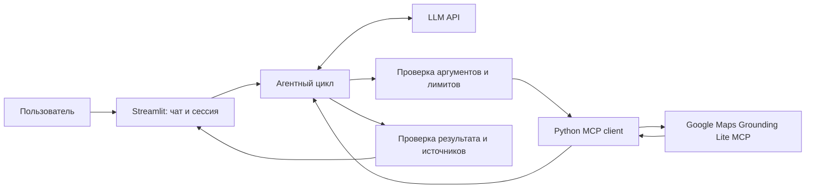

# План доведения DayOut до сдачи

Обновлено: 27 октября 2026 года. План, а не отчёт о завершённых функциях.
Основание — критерии курса, предоставленные пользователем; сверка с текущей
реализацией приведена в [course-review.md](course-review.md).

## Отправная точка

Реализован локальный агент: Groq qwen/qwen3.8-27b выбирает инструмент, Python
проверяет JSON Schema, вызывает официальный Google Maps MCP и возвращает данные
модели. Есть диалог, источники, учёт токенов, лимиты, безопасные ошибки и ручное
продолжение незавершённого хода. Диагностика вынесена в mcp_check.py/groq_check.py.
Реальные поиск и уточнения выполнялись; последний технический прогон — 128 passed.
Подробности изменений и наблюдавшихся ошибок — в README, error-analysis.md и
token-usage.md. Подтверждён Global ZDR; модель/тариф автоматически не меняются.

Веб-интерфейс Streamlit уже реализован и проверен локально: app.py и web_backend.py.
Есть раздельные сеансы, статусы, повтор/проверка связи и общий ограничитель нагрузки.
Последний прогон — 144 теста; живая проверка веб-адаптера и поиска в браузере прошла.
Публичного деплоя, фиксированного набора Eval и HTML-презентации пока нет.
Качество описаний и сохранение всех условий в длинном диалоге не измерены.
Погода вызывалась в пользовательских прогонах; правильность погоды и маршрутов
как готовых возможностей ещё требуется подтвердить. Есть сетевые сбои и паузы
бесплатной квоты; последняя живая проверка остановилась при подключении к MCP.

Практический порядок оставшейся работы: зафиксировать защищаемый MVP → веб-чат →
ранний деплой и проверка внешних API → Eval и адресные исправления → итоговый README,
публичный репозиторий, HTML-презентация → репетиция и сдача двух ссылок.
Работу по отдельному репозиторию и структуре материалов можно вести параллельно
по времени с этими этапами. Новые функции добавлять только при необходимости MVP.

## 1. Зафиксировать объём и критерии готовности

Целевой пользователь: человек, планирующий несколько часов досуга в Москве
самостоятельно, вдвоём или небольшой компанией. Стартовый географический
фокус — Москва; выход за него явно обозначать как выход за проверенный MVP.
Это предлагаемое сужение для воспроизводимого Eval, которое можно расширить позже.

Основной сценарий: пользователь сообщает город/район, время, интересы, состав
компании и бюджет; получает 2–3 альтернативы и уточняет одну из них в диалоге.
Минимальный результат: 1–2 места в каждом сценарии, объяснение выбора,
подтверждённые адреса и источники; для двух мест — проверенный переход.
Если данных недостаточно, агент уточняет критичный параметр или объясняет,
почему не может сформировать нужное число вариантов. Не заполняет ответ выдумками.

Входят: чат, LLM с tool calling, search_places, погодный запрос по необходимости,
compute_routes для переходов, ограничения вызовов/времени, атрибуция, Eval и деплой.
Не входят: аккаунты, БД, постоянная история, избранное, платежи, бронирование,
поиск билетов, интерактивная карта, несколько UI и несколько агентов.
Общественный транспорт не обещать: текущий инструмент маршрутов поддерживает
пешие и автомобильные маршруты.

Бюджет трактовать как ограничение пользователя, а не подтверждённую стоимость:
без цен нельзя гарантировать укладывание в сумму. Неизвестные цены и доступность
билетов обозначать явно. Предпочтения вроде «тихо» считать качественными и
пояснять степень подтверждения. При недоступных адресах явно сообщать об этом.

По решению пользователя используется официальный Google Maps Grounding Lite MCP;
собственный сервер не разрабатывается и не нужен для продолжения плана.
Статус согласования темы с преподавателем фиксируется отдельно без выдуманного подтверждения.

Готово, когда: пользователь, сценарий, границы, ограничения и критерии приёмки
внесены в README; статус согласования указан честно.

## 2. Проверить инструменты выбранной LLM

- LLM уже выбрана и подключена: текущую модель сохранить до Eval. Смена модели
  рассматривается при повторяющихся измеренных провалах, после отдельной проверки
  доступности бесплатного тарифа и условий работы с Maps Content.
- Проверить совместимость конкретного API и тарифа с Maps Content, включая
  хранение, кэширование и обучение. Не подключать платные услуги без согласия.
- Реально вызвать lookup_weather и compute_routes с аргументами из list_tools().
- Проверить, как search_places отвечает на запрос полного адреса: текущий
  ответ по музеям содержит координаты и ссылки, но не отдельные адреса.
- Разбирать structuredContent, с поддержкой JSON в текстовом content, если
  сервер не предоставляет структурированного объекта. Сохранять соответствие
  ссылок [0], [1] и элементов places; не считать summary безусловно точным фактом.

Готово, когда: выбран доступный API, условия зафиксированы, есть действительный
локальный ключ LLM; поиск/погода/маршрут проверены и ограничения ответов описаны.
Результаты этих проверок не подменять тестовыми ответами.

## 3. Проверить готового консольного агента на защищаемых сценариях

Агентный цикл уже реализован в agent.py, консольный UI — в dayout.py.
Сохранить диагностические скрипты; переиспользовать агент в веб-интерфейсе.
Избежать большого рефакторинга заранее.

Целевая схема:

LLM получает задачу, контекст и актуальные определения инструментов. При
tool call приложение проверяет имя и аргументы, вызывает MCP и возвращает
результат модели. После достаточных данных модель формирует итоговый ответ.
Инструмент выбирает LLM, а исполнение и лимиты контролирует приложение.

Добавить: уточнение города, контекст уточнений в сессии, обработку ошибок,
ограничение шагов и общего времени, запрет исполнения инструкций из внешних
ответов. Стартовый инженерный лимит — до 8 вызовов инструментов и до 120 секунд
на ход; проверить на реальных кейсах и скорректировать до основного Eval.
Лимиты выбирает проект; это не лимиты Google и не требование курса.

Вывод должен отделять полученные факты от предложений агента: название,
адрес при наличии, почему подходит, предполагаемая длительность посещения
как оценка, цена/неизвестность, источник, подтверждённый переход между местами.
Если маршрут недоступен, не придумывать минуты в пути.

Готово, когда: один полноценный запрос даёт 2–3 сценария через реальные вызовы,
а уточнение «уменьши бюджет и исключи улицу» сохраняет остальной контекст.
Видно, какие инструменты вызваны, сколько их было и сколько занял ход; ключи
и необработанные Maps Content в постоянные логи не попадают.

## 4. Добавить простой UI и рано проверить хостинг

Streamlit: русскоязычный чат, примеры запросов, индикатор работы, понятные
ошибки, сброс диалога, читаемые сценарии и ссылки Google Maps рядом с фактами.
Технические JSON-схемы оставить в диагностическом CLI. Для демо можно показать
краткий список реально выполненных инструментов без ключей и сырого ответа.

Выбрать один совместимый Python-хостинг после проверки актуальных условий.
Секреты передавать через настройки хостинга; проверить исходящий HTTPS к MCP
и LLM, работу asyncio/сессий, квоты и перезапуск. Не полагаться на VPN и настройки
локального компьютера. Ограничить частоту запросов и одновременную нагрузку
простым способом для защиты квот публичного демо.

Проверить чистое окружение на выбранной версии Python; зафиксировать установку
и параметры запуска. Публичные URL, аккаунт и тариф нельзя выдумывать.
Оплату не подключать без согласия. Проверка работающей ссылки обязательна.

Готово, когда: сервис открывается в отдельном браузере без окружения разработчика,
обрабатывает запрос, продолжает диалог; контексты двух сессий не смешиваются.
Проверка на хостинге идёт до основного Eval, чтобы рано обнаружить сетевые проблемы.

## 5. Провести Eval и исправить основные ошибки

Технические pytest-тесты проверяют программу; Eval проверяет качество всей
системы на пользовательских запросах. 128 прошедших тестов не заменяют Eval.

Предлагаемый минимальный набор — 20 заранее записанных кейсов:

| Группа | Количество | Что проверить |
|---|---:|---|
| Базовые | 5 | Интересы, район, пара/семья/один, различие альтернатив |
| Ограничения | 5 | Дождь, малый бюджет, 2 часа, короткая ходьба, сочетание условий |
| Уточнения диалога | 3 | Изменить район/бюджет/интерес, сохранив остальные условия |
| Неполные и сложные данные | 4 | Нет города, противоречивое время, неизвестная цена, пустая выдача |
| Сбои | 3 | Таймаут/сеть, отказ доступа, превышение квоты |

Кейсы с погодой должны фиксировать дату и местное время, а не зависеть от слова
«завтра» при повторных прогонах. Для диалогов записывать всю последовательность ходов.
Отсутствующие поля и ошибки воспроизводить контролируемыми подменами и явно
помечать такие прогоны. Не добиваться ошибок массовыми запросами или утечкой ключей.
Каждый кейс пометить live или simulated; результаты этих групп считать отдельно.

До запуска определить ожидаемое поведение и следующие проверки:

- Соблюдены явные ограничения или объяснено, почему проверить их нельзя.
- Места и ссылки имеют опору в фактическом ответе инструмента; нет добавленных
  без источника адресов, цен и времени в пути. Соответствие сравнивать при прогоне.
- Нужный инструмент выбран и получил корректные аргументы.
- В обычном полном запросе есть 2–3 различающихся сценария либо обоснование нехватки данных.
- Уточнение сохраняет остальные условия; ошибки не превращаются в выдуманный успех.
- Измерены длительность, число вызовов и, если API возвращает usage, токены/стоимость.

Для каждого применимого пункта ставить pass/fail; неприменимые отмечать N/A.
Кейс успешен, если все его обязательные проверки пройдены. Отдельно публиковать
долю успешных кейсов и ошибки по каждому пункту с явными знаменателями.
Предлагаемая внутренняя цель: минимум 80% успешных обычных live-кейсов,
100% сценариев с источниками и 0 неподтверждённых фактических утверждений
в проверенной выборке. Это целевые значения проекта, а не результаты или порог курса.

Пять live-кейсов выполнить по три раза: итог — 20 базовых прогонов и 10 повторов.
Повторы показывают изменчивость, но не доказывают стабильность при любой нагрузке.
Квоту и расходы проверить заранее. Отчёт: версия кода, модель и параметры,
окружение, даты, набор кейсов, результаты, длительности, ограничения.

Разбор ошибок: минимум три наблюдавшихся типа проблем, причина, изменение,
повторная проверка проваленных и связанных кейсов, оставшиеся ограничения.
Если ошибок не наблюдалось, не выдумывать их: описать объём проверки и риски.
Maps Content не копировать в постоянный публичный датасет; сохранять входные
кейсы без личных данных и агрегированные оценки, ошибки описывать своими словами.

Готово, когда: есть реальные результаты, отдельные метрики live/simulated,
разбор ошибок и возможность повторить процедуру; основное изложено в README.

## 6. Собрать публичные материалы и подготовить защиту

Использовать отдельный репозиторий именно для DayOut. Для публикации подготовлена
его отдельная локальная копия. Домашний каталог и его история в проект не входят.
До загрузки проверить состав файлов и отсутствие секретов, включая историю;
ранее показанный в чате ключ заменить перед публичным запуском.

README сделать основным документом сдачи, включив все разделы:

1. Название и задача.
2. Пользователь и сценарий.
3. Границы MVP, критерии готовности и статус согласования темы.
4. Фактическая архитектурная схема.
5. MCP-схема: официальный внешний сервер, транспорт, авторизация, инструменты.
6. AI-логика: модель, prompt, выбор инструментов, цикл, ограничения, контекст.
7. Воспроизводимый запуск и деплой, секреты, ссылка на сервис.
8. Eval: методика, результаты, ошибки, исправления и ограничения.
9. Использованные источники и ссылка на интерактивную HTML-презентацию.

HTML-презентация: один presentation.html без обязательного сервера, навигация
кнопками/клавиатурой, 7–9 экранов, схема, результаты Eval, ссылка на живое демо.
Содержание строить по фактическим результатам; будущие возможности отделить.
Опубликовать сервис и репозиторий в рамках отдельно согласованного действия;
само текущее планирование ничего не публикует.

Репетиция до 10 минут: 1 минута задача/MVP, 2 минуты архитектура и агент,
3 минуты живой запрос и уточнение, 2 минуты Eval/ошибки, 1 минута ограничения
и итог; оставшаяся минута — запас. Подготовить ответы: зачем MCP, зачем LLM,
чем Eval отличается от pytest, как предотвращаются выдумки и что при сбое API.

Готово, когда: README самодостаточен; репозиторий и сервис доступны по ссылкам,
HTML открывается; независимый запуск и репетиция проходят. Две итоговые ссылки
готовы для LMS. Неизвестный срок сдачи в план не подставляется.

## Ближайшее действие

Консольный агент и веб-чат реализованы, реальный поиск через веб-адаптер прошёл.
Следующий этап — загрузка текущих файлов в предоставленный репозиторий
Batyaoftheyear/DayOut-AI-agent и ранний деплой по [deployment.md](deployment.md). Затем основной
Eval и исправления по измеренным провалам. До защиты проверить все заявленные
функции; непроверенные возможности исключить из обещаний MVP либо довести до
критериев приёмки. Используется официальный Google Maps MCP; отдельный сервер исключён из объёма.
